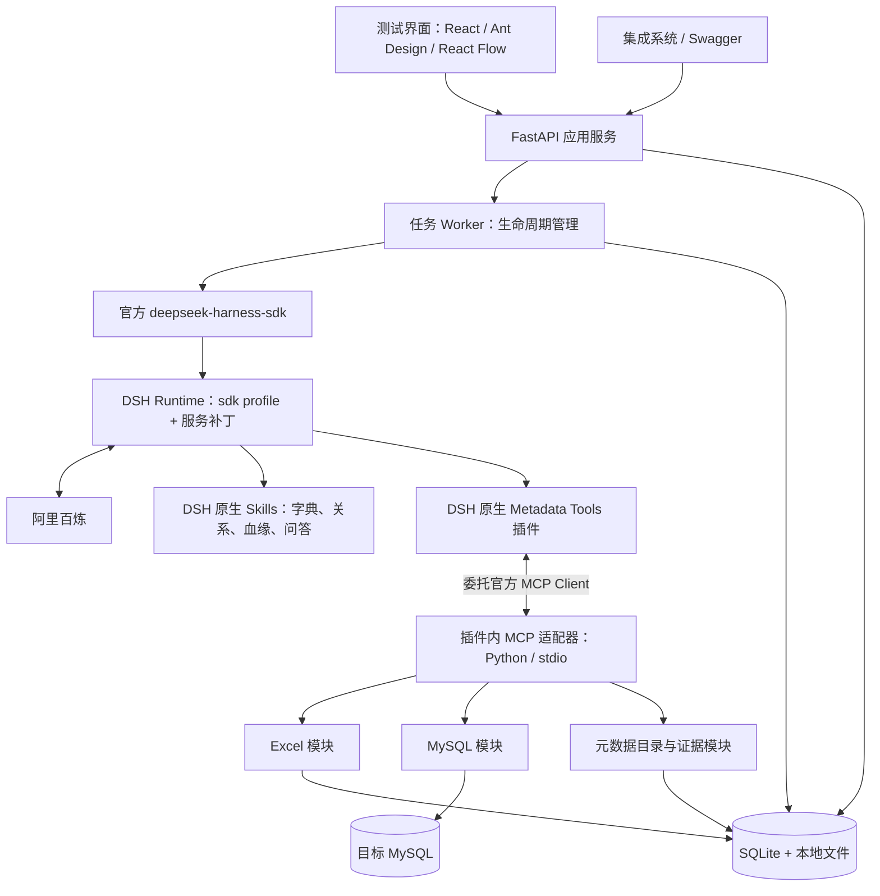
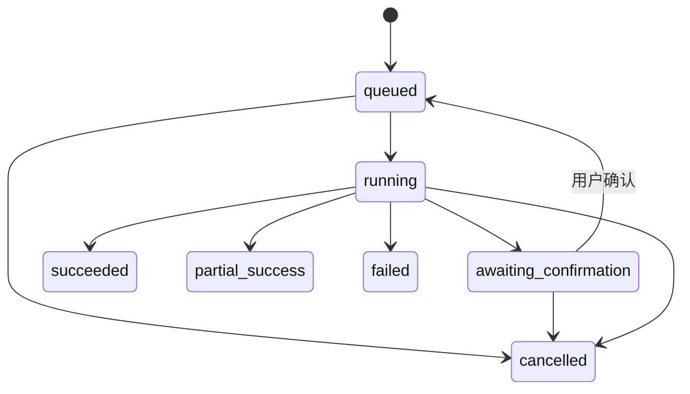

# 元数据分析智能体技术架构

状态：修订后的第一版设计基线；已开始实现，当前验证范围与待办见 [实施记录](implementation.md)。

更新日期：2026-10-10。

配套文档：[需求说明](requirements.md) · [项目入口](../README.md)。

## 1. 核心决策与现状

**DSH 是唯一智能体运行时。** 模型调用、Agent 执行循环、工具选择和调用、上下文管理及会话持久化均由 DSH 承担。不实现自建 ReAct 循环，不从自然语言模拟工具调用，不引入第二套 Agent 框架。

**全部分析由 DSH 执行。** Excel 布局识别与字典解读、键语义、关系推断、ER 建模、SQL 血缘、影响分析和问答都由 DSH 结合 Skills 与证据完成。Python 服务只负责 HTTP、任务生命周期、人工确认、DSH 结果的结构化校验、存储和展示，不能自行推断或补齐结果。

**MCP 工具由 DSH 插件实现并加载。** 项目插件使用官方 MCP Client 管理工具接入和生命周期；插件内的工具适配器只做原始 Excel/数据库证据读取、受控查询及结果提交，不提供替代 DSH 的分析算法。插件可以使用 Python MCP SDK 实现 stdio 适配器，语言选择不改变职责边界。

当前仓库保留官方 SDK、`sdk` profile、百炼接入和 CLI 示例，已新增 API、Worker、DSH 插件、原生 Skills、结构化结果存储与测试界面。实现与验证状态单独记录；现有 CLI 不能直接作为服务安全边界。

## 2. 总体结构与职责

| 组件 | 技术 | 职责 |
| --- | --- | --- |
| 应用服务 | FastAPI、Pydantic、Uvicorn | HTTP、文件接收、数据源管理、用户确认、结果查询与导出 |
| Worker | Python + 官方 Harness SDK | 领取任务、创建环境、启动 DSH、订阅事件、超时取消与资源回收 |
| Agent Runtime | DSH `sdk` profile | 理解目标、探索规划、工具调用、上下文及会话管理 |
| 模型适配 | DSH `llm-pi-ai` + 百炼 | 模型路由和凭据引用，延续现有配置 |
| DSH Metadata Tools 插件 | 原生 Cordis 插件 + 官方 MCP Client + 插件内 Python MCP SDK 适配器 | 管理工具生命周期；读取证据、范围限制、受控查询和结果提交 |
| Excel 能力库 | openpyxl / xlrd | `.xlsx` / `.xls` 内容、坐标、合并区域及格式提取 |
| MySQL 能力库 | SQLAlchemy 2 + PyMySQL | 结构反射、定义读取、受控数据指标和验证 |
| 分析方法 | DSH 原生 Skills | DSH 完成字典、关联、ER、SQL 血缘与问答分析；不存在独立 Python 血缘引擎 |
| 结果持久化 | SQLite、SQLAlchemy、Alembic | 任务、草稿、快照、证据、审核和问答 |
| 测试界面 | React、TypeScript、Vite、Ant Design | 数据源、预览确认、任务、图、问答和导出 |
| 图组件 | React Flow + ELK.js | 自定义表节点、字段连线、布局及局部展开 |

第一版无需 Redis、Neo4j 或向量数据库。元数据检索采用对象名称、注释与索引查询，关系遍历读取持久化边。

## 3. 应用服务与 DSH 的边界

### 3.1 上层可以做什么

Python 封装层包名为 `metadata_service`，不是 Agent。它提供 DSH 智能体的服务接口；真正的智能体运行时、插件及 Skills 属于 DSH。启动命令为 `uv run python -m metadata_service`，API 工厂为 `metadata_service.api:create_app`。

应用服务发起分析和问答，管理数据源、用户修正、任务队列和结果展示。Worker 管理进程与应用状态，通过 SDK 发送任务消息、接收通知和最终执行状态。

连接测试和范围选择属于接口前置操作，可调用插件的只读 I/O 适配器；结果查询和导出只读取已保存的 DSH 产物。服务层不得直接调用任何业务分析器。上传阶段只验证文件格式、大小和资源限制，不识别业务表块。

Worker 不决定下一步调用哪个工具，不根据模型文本编写工具执行分支。等待用户确认后再发送消息属于业务交互，不属于自建 Agent 循环。

### 3.2 DSH 服务配置

- 以现有 `sdk` profile 为基础，新建独立服务补丁；示例 profile 与服务 profile 的配置和产物分离。
- 加载百炼适配器、官方 MCP Client、会话存储和必要的上下文服务。
- 禁用 shell、文件修改、通用 Web、通用 SQL MCP 和无关工具；启动集成测试核对模型实际可见的工具清单。
- Excel、数据库、问答分别维护任务提示词，说明目标、证据要求、工具预算和提交契约。提示词通过 DSH 配置或任务消息加载，不依赖 MCP Prompt Templates。
- 分析和问答使用不同的 MCP 工具清单；问答只挂载元数据只读工具与 `save_answer`，不开放业务库工具。
- profile 配置从受控模板生成，不允许请求上传任意 DSH 补丁或本地插件路径。

每次活跃执行创建独立 Harness 实例、session、workspace 与 home。持久化逻辑分析任务、对话和执行实例的对应关系；独立执行之间通过草稿及已保存问答记录衔接，不共享一个全局 Harness。

### 3.3 插件使用原则

插件实现位于 `dsh/plugins/metadata_tools/`：`index.mjs` 是原生 Cordis 插件入口，委托官方 MCP Client；`server.py` 注册任务范围内的 MCP 工具，`excel.py`、`mysql.py` 负责证据 I/O，`capabilities.py` 执行工具契约。Worker 将原生入口复制到隔离 profile 并加载，MCP 适配器由插件启动和回收。

分析方法位于 `dsh/skills/analysis/`，问答位于 `dsh/skills/qa/`，通过官方 Skill 发现机制加载。Python 不实现 Skill 解释器或 Agent 循环。工具不会自动创建关系或血缘；包括真实外键在内，DSH 根据原始约束证据整理并提交结构化关系。插件仅核对声明约束是否有对应原始证据，不能把推断升级成声明。stdout 不输出普通日志。

## 4. Metadata MCP 工具契约

一个任务由 DSH 插件启动一个 Metadata MCP Server，包含 Excel 证据、MySQL 证据、元数据目录/交付三个工具模块；SQL 血缘是 DSH Skill 分析能力，不是第四个 Python 工具模块。Server 在启动时绑定任务、数据源或快照及预算；工具参数不能自行切换到其他任务或任意连接。

所有工具采用结构化输入与结果校验。公共结果包含 `data`、`evidence_ids`、`warnings`、可选分页游标和当前预算摘要。错误使用稳定错误码，通过 MCP 工具错误返回，不伪装为成功的空结果。分页、批量和样本结果必须有边界。

| 模块 / 工具 | 关键输入 | 关键输出与约束 |
| --- | --- | --- |
| Excel `inspect_workbook` | 已绑定文件，可选 Sheet 范围 | Sheet、尺寸、合并单元格；表块识别由 DSH 完成，不返回整个工作簿 |
| Excel `read_region` | Sheet、单元格范围、分页 | 原始值、坐标及布局信息；限制区域大小 |
| Excel `save_dictionary_draft` | 表、字段、键、来源范围 | 通过校验的草稿版本、告警；确认后的内容不能被自动覆盖 |
| MySQL `list_objects` | 已选范围、分页 | 数据库、表和视图标识 |
| MySQL `describe_tables` | 范围内表 ID 列表 | 字段、键、索引、注释等结构证据 |
| MySQL `get_sql_definition` | 对象 ID、类型 | SQL 定义及可见性告警 |
| MySQL `profile_columns` | 对象字段、指标类型 | 有界查询的空值、唯一性等指标及范围 |
| MySQL `validate_relationship` | 候选两端有序字段组 | 引用匹配、空值等指标；不接受自由 SQL |
| MySQL `sample_rows` | 对象、所需字段及数量 | 符合发送预算的有限原始样本；关闭样本时拒绝返回值 |
| 目录 `search_metadata` | 搜索词、对象类型、分页 | 当前任务或快照内的对象摘要 |
| 目录 `get_neighbors` | 对象、关联/血缘、方向及深度 | 有界子图，默认一跳 |
| 目录 `read_evidence` | 证据 ID 列表 | 原始坐标、约束、SQL 片段或验证指标 |
| 目录 `save_findings` | 结构化分批发现、幂等键 | 草稿结果 ID、校验错误或告警 |
| 目录 `finalize_snapshot` | 草稿版本、覆盖范围、未解决项 | 合法快照 ID、发布状态或校验错误 |
| 目录 `save_answer` | 答案正文、证据 ID、会话消息 ID | 保存后的答案 ID；引用必须属于绑定快照 |

工具限制在代码中强制执行。数据库标识从已授权对象集合解析，查询值使用参数绑定；禁止运行模型提交的任意 SQL。查询模板不允许 DML、DDL、存储过程调用、文件操作、锁定查询或其他有副作用操作。

DSH 加载 `metadata-lineage` Skill，读取原始 SQL、schema 与证据，自行分析 JOIN、CTE、表达式以及明确的加工语句，通过 `save_findings` 提交表级/字段级血缘和未知项。Python 不使用 SQLGlot，不解析语义、不生成或修复血缘边。结构校验只检查字段格式、对象引用、证据归属和确认边界，不能证明分析语义正确；语义正确性通过 DSH 场景验收和人工证据审核验证。空值、去重和引用匹配等受控计数只是证据指标，关系是否成立、置信等级和解释由 DSH 决定。

MCP 启动凭据显式配置。DSH 官方 MCP Client 会清理部分敏感环境变量，不假设 MCP 自动继承父进程的 Key、Password、Token 或全部 DSH 配置。

## 5. 数据模型与结构化交付

### 5.1 核心模型

| 模型 | 关键内容 |
| --- | --- |
| Source | 来源类型、文件标识或连接配置、加密凭据引用、选定对象范围 |
| AnalysisJob | 来源、状态、阶段、预算、告警、错误、执行记录、草稿和快照引用 |
| Execution | 单次 DSH 执行的 session、隔离目录、时间、终止状态及诊断引用 |
| Snapshot | 来源、发布时间、覆盖范围、未解决项和结果版本 |
| Table / Column | 原始标识、类型、注释、属性和来源证据 |
| KeyConstraint | 键类型、有序字段组、声明来源及约束名称 |
| Relationship | 两端字段组、来源、置信等级、验证指标、审核状态及证据 |
| LineageEdge | 源与目标对象、表/字段层级、表达式、解析状态及证据 |
| Evidence | 证据类型、来源定位、内容摘要、采集方法及范围 |
| Review | 关系修订、确认或驳回、说明和时间；单机版不假设已有用户身份体系 |
| Conversation / Answer | 绑定快照、消息、答案正文、证据引用与执行记录 |

关系与血缘独立建模；复合键以字段组表示。草稿和已发布快照分离，人工审核以附加记录和结果投影保存，保留原始发现。源快照不因问答而改变。

### 5.2 交付与成功条件

DSH 通过 `save_findings` 分批写入，Pydantic 校验对象引用、字段组和证据范围；`finalize_snapshot` 校验草稿一致性后在事务中发布结果。

Worker 仅在 DSH 正常完成且存在本次执行发布的合法快照时，将分析任务标记为成功或部分成功。问答必须存在本次执行保存的合法答案。最终自然语言回答是摘要，不是元数据落库协议。

幂等键与任务范围绑定，重复工具调用不重复创建发现。重试建立新执行记录并读取已有草稿，不自动重复已完成的写入。工具错误交给 DSH 处理，不在上层创建模型输出修复循环。

SQLite 使用短事务和有限锁等待，模型调用与数据库采样期间不持有 SQLite 写事务；业务采集库与元数据结果库是两种独立连接。

## 6. 执行流程与任务状态

### 6.1 Excel

上传保存 → 排队 → DSH 调用 Excel 工具识别并保存草稿 → 等待确认并释放 DSH/MCP → 用户修正并确认 → 排队继续 → 新 DSH 执行读取确认稿并探索关系 → 发布快照。

继续执行仍属于同一逻辑分析任务，继承累计预算和草稿版本，但不依赖一直存活的进程。DSH 获得用户确认后的新消息，不让 API 自行执行分析推理。

### 6.2 MySQL

配置与连接测试 → 选定范围 → 排队 → DSH 采集结构及定义 → 自主选择候选与受控验证 → DSH 按 Skill 分析 SQL 血缘 → 保存发现 → 发布快照。

Excel 和 MySQL 结果不会自动合并。数据定义不可见或验证失败时，由结果覆盖范围和告警说明缺失，允许合法的部分成功。

### 6.3 问答

绑定快照与会话 → 排队 → 为问答启动独立 DSH 执行 → 读取相关对话记录、搜索对象及证据 → `save_answer` → 结束执行。问答 profile 无业务库查询能力。

### 6.4 状态规则

取消先记录取消请求，Worker 停止任务进程树并回收 MCP，确认停止后才标记 `cancelled`。任务终态不可被晚到的执行事件覆盖。

服务重启保留排队、等待确认及已发布结果；将失去执行进程的运行任务标记为失败，错误码 `EXECUTION_INTERRUPTED`，可显式重试。重试创建关联的新执行/任务记录，不篡改原有终态，不自动重复模型费用和查询。

进度包含当前阶段、实际完成计数和预算；DSH SDK 通知用作诊断投影，MCP 阶段和产物记录作为业务进度依据。

## 7. REST API 与测试界面

所有接口位于 `/api/v1`，提供 Swagger `/docs`；分析和问答请求返回 `202` 与任务 ID。公开响应不含连接密码、主密钥或服务器绝对文件路径。

| 方法与路径 | 主要行为 |
| --- | --- |
| `POST /sources/excel` | multipart 上传，返回 Source ID |
| `POST /sources/mysql` | 保存连接参数与加密凭据，返回脱敏的数据源信息 |
| `POST /sources/{id}/test` | 确定性连接测试，返回版本、可达性和权限告警 |
| `GET /sources/{id}/objects` | 分页列出可选数据库/表；Excel 的已识别对象由草稿接口提供 |
| `POST /analyses` | 接收 Source ID、范围和分析选项，返回任务 ID |
| `GET /analyses/{id}` | 状态、阶段、预算、告警及快照引用 |
| `GET /analyses/{id}/preview` | Excel 表块、映射、草稿版本及证据坐标 |
| `PUT /analyses/{id}/mapping` | 保存人工修正，校验草稿版本避免覆盖并发修改 |
| `POST /analyses/{id}/confirm` | 确认草稿并入队继续，重复确认不重复派发 |
| `POST /analyses/{id}/cancel` | 请求取消，返回当前状态 |
| `POST /analyses/{id}/retry` | 创建关联的重试任务，返回新任务 ID |
| `GET /snapshots/{id}/tables` | 分页查询表与字段，支持搜索 |
| `GET /snapshots/{id}/graph` | `kind=er/lineage`、层级、方向、根对象和展开范围 |
| `GET /snapshots/{id}/evidence/{evidence_id}` | 查询当前快照的证据 |
| `PATCH /relationships/{id}` | 审核或更正候选，保存变更记录 |
| `POST /snapshots/{id}/questions` | 提交问题及可选会话 ID，返回问答任务 ID |
| `GET /conversations/{id}` | 查询已有问题、答案及证据引用 |
| `GET /snapshots/{id}/exports/{format}` | 下载 JSON/CSV；SVG/PNG 由前端导出当前图 |
| `POST /analyses/{id}/cleanup` | 仅清理已停止任务的原文件、临时产物和会话；保留快照与明确的证据不可用标记 |

界面采用中文桌面工作台：数据源 → Excel 预览 → 任务详情 → 元数据浏览 → ER/血缘 → 问答。图与列表共享过滤条件，右侧显示对象或关系证据，审核操作保留原始来源。

默认每两秒查询任务状态，终态停止轮询。等待确认、空结果、未知依赖、部分成功和失败均有独立展示。图默认一跳、按需展开；表字段列表分页，不一次渲染全部图节点。

## 8. 隔离、配置与单机部署

### 8.1 配置与目录

代码仓库包含应用、MCP、前端、受控 DSH 模板、数据库迁移、测试夹具及 `.env.example`。运行数据统一放到被 Git 忽略的本地数据根目录，按任务和执行 ID 划分上传、workspace、Harness home、草稿及导出目录。

百炼配置延续 `llm-pi-ai.providers.bailian` 和 `BAILIAN_API_KEY`。服务显式加载本地配置并传给 DSH，不依赖启动脚本所在目录碰巧匹配 `.env`。

动态数据库密码加密保存；优先通过环境或忽略的 `.env` 提供 `METADATA_MASTER_KEY`。本机未设置时生成被 Git 忽略的 `data/.master.key`，与结果库一同备份、限制访问；这只是本地测试的便利回退。MCP 仅取得绑定数据源所需凭据，不把密码放入工具参数、模型上下文或普通日志。模板、API 示例和测试夹具均使用占位符。

### 8.2 默认执行配置

规模、查询及样本预算以[需求默认限制](requirements.md#6-默认限制与数据处理)为准。超时采用以下可配置设计默认值，不允许无限等待：

| 配置 | 默认值 |
| --- | --- |
| MySQL 连接 / 查询超时 | 10 秒 / 30 秒 |
| 单次 MCP 工具超时 | 60 秒 |
| DSH 初始化 / SDK 请求超时 | 60 秒 / 180 秒 |
| 每次活跃 DSH 执行总时限 | 30 分钟；等待用户确认不计入 |
| 取消后进程退出宽限 | 5 秒，随后终止并回收所属进程树 |
| Excel 解压内容 / 有效单元格上限 | 200MB / 1,000,000 个，超出拒绝 |

查询超时要在驱动和数据库可支持的执行限制上同时落实，不能只靠 HTTP 请求结束。关系验证、指标和样本查询共享 30 次预算；结构目录读取单独计数并受任务时限约束。行数限制不能代替扫描成本控制，对无法提供有界执行方法的验证返回未执行原因。

样本工具返回前截断行数和字段长度并记账；已关闭样本时仍可返回聚合指标。原始样本可能进入 DSH 会话，界面必须在分析选项与清理说明中明确这一点。

### 8.3 进程与部署

Windows 本机优先，提供一个启动脚本管理 API 和独立 Worker，Worker 使用与项目一致的 Python 环境。生产构建的测试界面由 FastAPI 同源托管，前端开发使用 Vite 代理。

开发启动入口为 `bash ./start-dev.sh`：调用 `metadata_service.dev` 同时管理独立 Worker、Uvicorn reload API 和 Vite 前端，避免 Bash/MSYS PID 与 Windows PID 不一致。默认端口 API 8000、UI 5173；`METADATA_API_PORT`、`METADATA_UI_PORT` 可覆盖，前端代理随 API 端口同步。进程日志写入数据目录 `dev-logs/`，退出回收启动的进程树。API/前端热更新，插件、Skills 与 Worker 修改需要重启。Windows 使用 Git Bash，WSL 需使用 WSL 自己的 Python/Node/uv 环境。构建后的单端口入口为 `start-service.ps1` 或 `uv run python -m metadata_service`。

默认一个 Worker、一个活跃任务；任务队列持久化在 SQLite，领取任务使用事务避免重复执行。部署不需要 Redis、系统 Node.js 参与 DSH 执行或图数据库；前端构建需要 Node.js。

Worker 为任务创建专属进程组或等效进程树管理对象，正常退出和强制取消均回收 DSH 与 MCP 子进程。启动时校验必需 MCP 工具确实可用，不能只以 DSH 进程启动成功作为就绪条件。

清理接口只接受任务 ID，服务解析目录归属；禁止传入任意文件路径。保留已发布结构化快照，对被清理的原始证据明确显示不可用，不误指向其他任务文件。

## 9. 测试与实施顺序

### 9.1 测试策略

- 插件 I/O 与契约单测：Excel 原始区域、约束采集、查询模板、预算、证据、结构和发布校验，均可脱离模型测试；不在 Python 测试中运行血缘分析器。
- DSH 分析验收：通过真实 DSH 执行 Excel 识别、关系推断、ER 和 JOIN/CTE/表达式血缘，按固定证据与人工预期核对分析质量；工具契约测试不能替代该验收。
- MCP 契约测试：工具 schema、错误码、分页、任务范围、幂等写入、样本限制与工具清单。
- DSH 集成测试：通过官方 SDK 运行真实 DSH，验证工具发现、调用事件、工具错误反馈、合法结果发布和进程回收；稳定场景使用可控模型端点。
- API 测试：上传、预览确认、状态机、重试、取消、清理、图查询及答案证据引用。
- 前端端到端：文件与数据库两入口、任务轮询、图过滤展开、关系审核、问答跳转及导出。
- 百炼真实验证：显式启用，使用独立测试库及样例文件，核对 DSH 会话事件与正式产物，不以模型口头报告替代工具证据。

验收场景以[需求验收表](requirements.md#7-验收与异常场景)为准。除模型调用外，工具查询数量、超时、退出进程数、证据覆盖率和异常阶段应可诊断；不记录实际密码。

### 9.2 分阶段交付

1. 架构骨架：FastAPI → Worker → 官方 SDK → DSH → Metadata MCP，完成结构化写入、结果发布与回收验证。
2. 数据库入口：插件采集结构及定义，DSH 分析关系与字段血缘，插件提供受控查询和目录。
3. Excel 入口：布局读取、DSH 识别、人工修正、确认后继续分析。
4. 完整交互：ER/血缘图、关系审核、元数据问答、导出和两入口端到端验收。

每阶段保持现有 CLI 示例可运行；服务使用独立运行数据，不迁移或混用已有示例会话。

## 10. 参考资料

- [DSH Python SDK](https://github.com/deepseek-ai/deepseek-harness/blob/master/python/sdk/README.md)：官方进程与会话入口。
- [DSH MCP Client](https://github.com/deepseek-ai/deepseek-harness/blob/master/packages/mcp/mcp-client/README.md)：工具注册、stdio 和环境变量处理。
- [FastAPI 文件上传](https://fastapi.tiangolo.com/tutorial/request-files/)：HTTP 文件入口。
- [SQLAlchemy 数据库反射](https://docs.sqlalchemy.org/en/20/core/reflection.html)：结构采集。
- [React Flow 与 ELK.js](https://reactflow.dev/examples/layout/elkjs-multiple-handles)：字段端口和图布局。

实际实施以项目锁定的依赖版本为准；DSH 的 profile、工具事件和取消能力须通过集成测试确认，文档链接不替代当前安装版本验证。

## 11. 代码与文档一致性

遵循 [agent.md 公约](../agent.md)：代码与需求、架构、相关 README/Skills 同步修改、同步审查、同次提交。职责、工具契约或默认限制发生变化时，交付前必须核对文档与实际代码；实施记录明确未实现及未验证范围。本次边界修订以 DSH 承担全部分析、MCP 属于 DSH 插件为准，替代旧版 SQL 静态分析工具方案。
